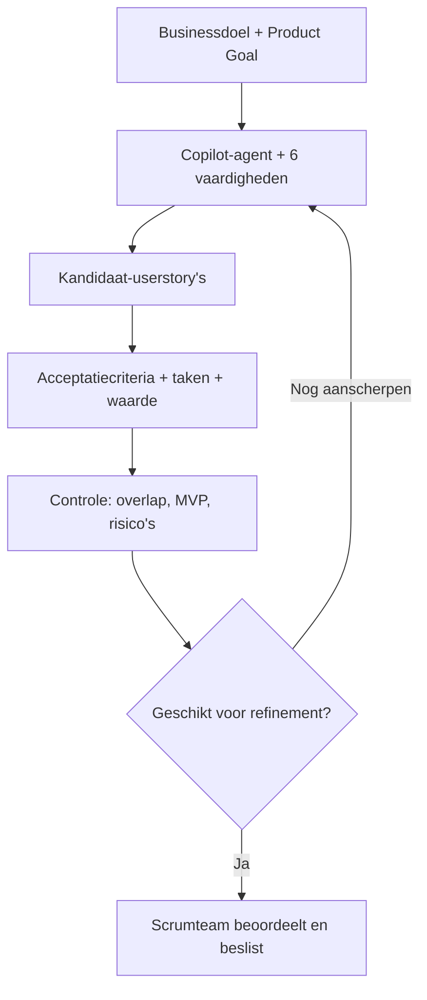

<div align="center">

# Project 721
### AI Backlog Refinement Agent

**Van businessdoelen en Product Goal naar waardevolle, toetsbare userstory's.**

Projectteam 721 · Hogeschool Utrecht · Microsoft 365 Copilot

[](https://github.com/Zer0Stride/Project-721-AI-Agent/actions/workflows/demo-tests.yml)


**[Ontwikkelproces](docs/01-ontwikkelproces.md) · [Skills & prompts](docs/02-promptontwerp.md) · [Refinement](docs/07-refinement-terugkoppeling.md) · [Echte Copilot-test](docs/09-copilot-testresultaat.md) · [Demo & tests](#demo-en-automatische-tests)**

</div>

---

## Home dashboard

Dit is het centrale overzicht van de **AI Backlog Refinement Agent**. De agent ondersteunt het Scrumteam bij het vertalen van projectdoelen naar kandidaat-userstory's, toetsbare acceptatiecriteria en uitvoerbare taken. De uiteindelijke beoordeling en prioritering blijven bij het team.

### Project in één oogopslag

| Onderdeel | Stand van zaken | Wat betekent dit? |
|---|---|---|
| **Copilot-agent** | Ingericht | Organisatiespecifieke agent in Microsoft 365 Copilot |
| **6 vaardigheden** | Toegevoegd | Projectcontext, Scrum, techniek, Sprint 3, backlogreferentie en refinementfeedback |
| **3 startprompts** | Ingesteld | Userstory's maken, backlog analyseren en refinement voorbereiden |
| **Refinementfeedback** | Verwerkt · 03-11-2026 | Feedback is omgezet naar scherpere kwaliteitsregels in de zesde skill |
| **Echte Copilot-test** | Inhoudelijk beoordeeld | Twee kandidaatstories, acceptatiecriteria, taken en MVP-beoordeling |
| **Offline demonstratie** | Uitvoerbaar | Reproduceerbare Python-case met uitsluitend fictieve data |
| **Automatische controles** | 7 tests | Unit-tests via GitHub Actions; actuele uitslag in de badge bovenaan |

### Direct naar het juiste onderdeel

| Ik wil... | Bekijk |
|---|---|
| **Begrijpen waarom deze agent is gebouwd** | [Doel en ontwikkelproces](docs/01-ontwikkelproces.md) |
| **Zien wat de zes skills en prompts doen** | [Promptontwerp en vaardigheden](docs/02-promptontwerp.md) |
| **Voorbeelden van gegenereerde stories zien** | [Fictief storyvoorbeeld](docs/03-voorbeelduitvoer.md) |
| **Begrijpen hoe stories worden beoordeeld** | [Scrum en kwaliteitscriteria](docs/04-scrum-refinement.md) |
| **De ontvangen feedback en verbetering bekijken** | [Refinement 3 november](docs/07-refinement-terugkoppeling.md) · [Zesde skill](docs/08-refinement-skill.md) |
| **Het resultaat van de echte agenttest bekijken** | [Inhoudelijke Copilot-test](docs/09-copilot-testresultaat.md) |
| **De demonstratie zelf uitvoeren** | [Python-demo](demo/generate.py) · [Voorbeelddata](demo/voorbeeldcontext.json) · [Tests](tests/test_generate.py) |
| **De Sprint 3-oplevering en demonstratie bekijken** | [Sprint 3-overzicht](docs/05-sprint3.md) · [Sprint Review](docs/06-presentatie.md) |

## Wat kan de agent?

| Functie | Resultaat voor het Scrumteam |
|---|---|
| **Userstory's opstellen** | Kleine voorstellen in het formaat *Als [rol] wil ik [doel], zodat [waarde]* |
| **Waarde onderbouwen** | Businesswaarde en bijdrage aan Product Goal en een voorlopige MVP-hypothese |
| **Acceptatiecriteria formuleren** | Drie tot vijf observeerbare Given/When/Then-criteria |
| **Taken voorbereiden** | Concrete technische en organisatorische subtaken |
| **Backlogoverlap signaleren** | Vergelijking met beschikbare backloginformatie, inclusief peildatum waar mogelijk |
| **Refinement ondersteunen** | Kwaliteit beoordelen, aannames benoemen en verbeteringen voorstellen |

## Zes Copilot-vaardigheden

| # | Vaardigheid | Doel |
|:--:|---|---|
| 01 | **Projectcontext** | Legt de relatie tussen gebruikersbehoefte, businessdoel en Product Goal |
| 02 | **Scrum & refinement** | Ondersteunt storyformaat, acceptatiecriteria, taakverdeling en backlogbesluiten |
| 03 | **Technische randvoorwaarden** | Laat de agent rekening houden met uitvoerbaarheid, risico's en gegevensveiligheid |
| 04 | **Sprint 3-kwaliteit** | Controleert businesswaarde, MVP-bijdrage en de onderbouwing van voorstellen |
| 05 | **Backlogmomentopname** | Geeft bestaande werkzaamheden als referentie en helpt dubbel werk te vermijden |
| 06 | **Refinementfeedback** | Past de ontvangen feedback van 3 november toe bij het beoordelen en verbeteren van stories |

De zes vaardigheden zijn toegevoegd in de afgeschermde Copilot-omgeving. Deze openbare showcase bevat **geen interne skillbestanden of vertrouwelijke projectcontext**.

### Drie startprompts

| Prompt | Wanneer gebruiken? |
|---|---|
| **Genereer userstory's** | Van businessdoel en Product Goal naar kandidaatstories, criteria en taken |
| **Analyseer onze backlog** | Mogelijke overlap, afhankelijkheden en vervolgstappen identificeren |
| **Bereid een refinement voor** | Kritische vragen formuleren over scope, waarde, MVP en haalbaarheid |

## Van projectdoel naar refinement



**De agent genereert voorstellen, geen automatisch goedgekeurde backlogitems.** De kwaliteit van de beschikbare projectcontext bepaalt mede de kwaliteit van het resultaat.

## Verificatie en resultaten

### Echte test met Microsoft 365 Copilot

De aangeleverde agentoutput is inhoudelijk gecontroleerd op kwaliteit en MVP-relevantie:

| Geobserveerd resultaat | Uitkomst |
|---|---|
| Relevante bestaande backlogitems | 5 herkend |
| Kandidaat-userstory's | 2 opgesteld |
| Acceptatiecriteria | 5 per story |
| Taken en risico's | Aanwezig |
| Mogelijke duplicaten | Herkend; bestaande items verfijnen aanbevolen |
| Storyscore volgens de agent | 10/12 en 11/12 |

Dit zijn **scores van de agent zelf**, geen onafhankelijke goedkeuring of bewijs van een gerealiseerde MVP. Lees de [kritische analyse van de Copilot-test](docs/09-copilot-testresultaat.md) voor sterke punten en beperkingen.

### Refinement → verbetering van de agent

Op **3 november 2026** is feedback vastgelegd over vijf terugkerende kwaliteitsvragen:

| Feedback | Toegepaste verbetering |
|---|---|
| Is de gebruikerswaarde concreet? | Rol, behoefte en voordeel expliciet maken |
| Draagt de story bij aan de MVP? | Klein en aantoonbaar afbakenen |
| Zijn de criteria te testen? | Given/When/Then met observeerbaar resultaat |
| Is het werk al aanwezig? | Eerst mogelijke backlogoverlap onderzoeken |
| Zijn testgegevens veilig? | Synthetische of uitdrukkelijk goedgekeurde data gebruiken |

Het resultaat is de **zesde Copilot-skill**, vastgelegd in [de verbeterdocumentatie](docs/08-refinement-skill.md).

## Demo en automatische tests

Deze repository bevat naast de echte Copilot-agent een **zelfstandige, offline Python-demonstratie** met fictieve gegevens. Daarmee is de gewenste storystructuur reproduceerbaar zonder toegang tot de afgeschermde agent.

```bash
# Fictieve kandidaat-userstory's genereren
python demo/generate.py --input demo/voorbeeldcontext.json

# Zeven unit-tests uitvoeren
python -m unittest discover -s tests -v
```

De [GitHub Actions-workflow](.github/workflows/demo-tests.yml) voert de controles automatisch uit en publiceert de fictieve voorbeelduitvoer als workflowartifact. **De Python-demo is geen generatief model en vervangt de daadwerkelijke Copilot-test niet.**

## Projectbibliotheek

| Categorie | Document | Inhoud |
|---|---|---|
| **Ontwerp** | [01 · Ontwikkelproces](docs/01-ontwikkelproces.md) | Aanleiding, bronnen, inrichting en werkwijze |
| **Ontwerp** | [02 · Promptontwerp](docs/02-promptontwerp.md) | Instructies, startprompts en zes vaardigheden |
| **Demonstratie** | [03 · Voorbeelduitvoer](docs/03-voorbeelduitvoer.md) | Fictieve userstory's en acceptatiecriteria |
| **Kwaliteit** | [04 · Scrum & refinement](docs/04-scrum-refinement.md) | Scorekaart, beoordeling en teamrollen |
| **Oplevering** | [05 · Sprint 3](docs/05-sprint3.md) | Aansluiting op de challenge |
| **Presentatie** | [06 · Sprint Review](docs/06-presentatie.md) | Opbouw van de demonstratie |
| **Feedback** | [07 · Refinement](docs/07-refinement-terugkoppeling.md) | Terugkoppeling van 3 november 2026 |
| **Verbetering** | [08 · Zesde skill](docs/08-refinement-skill.md) | Toepassing van de feedback in de agent |
| **Validatie** | [09 · Copilot-testresultaat](docs/09-copilot-testresultaat.md) | Inhoudelijke beoordeling van echte agentoutput |
| **Templates** | [Userstory](templates/userstory.md) | Format voor nieuwe kandidaatstories |
| **Templates** | [Refinement](templates/refinement.md) | Formulier voor toekomstige beoordelingen |
| **Code** | [Python-demo](demo/generate.py) | Offline generatie met fictieve scenario's |
| **Code** | [Voorbeeldcontext](demo/voorbeeldcontext.json) | Fictieve testinput |
| **Code** | [Unit-tests](tests/test_generate.py) | Controle van format, veiligheid en overlap |
| **Project** | [Canvas-toelichting](CANVAS_INLEVERING.md) | Beknopte toelichting bij de oplevering |
| **Project** | [Publicatiechecklist](PUBLICATIECHECK.md) | Interne controle voor openbaar delen |

## Projectteam

**Projectteam 721 — Hogeschool Utrecht**  
**Gemaakt door:** Jesmar Oosterom en de overige teamleden.

*Deze repository laat de werkwijze, een beoordeelde Copilot-output en een veilige reproduceerbare demo zien. De achterliggende organisatiespecifieke kennis en interne backlogbestanden blijven afgeschermd.*
